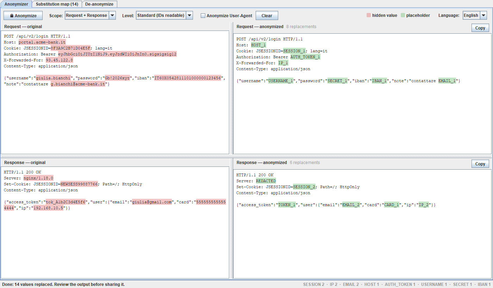
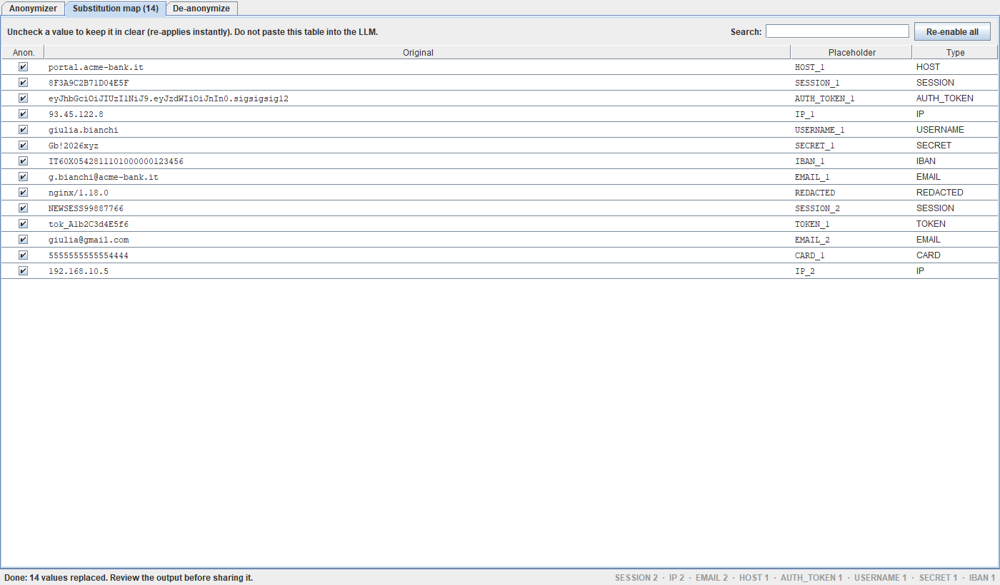

<p align="center">
  
</p>

<p align="center">
  <a href="https://github.com/Darnxca/Domi-Reversi---Sensitive-Data-Anonymizer---Burp-Extension/actions/workflows/ci.yml"></a>
  <a href="https://github.com/Darnxca/Domi-Reversi---Sensitive-Data-Anonymizer---Burp-Extension/actions/workflows/codeql.yml"></a>
  <a href="https://github.com/Darnxca/Domi-Reversi---Sensitive-Data-Anonymizer---Burp-Extension/releases/latest"></a>
  
  
  <a href="LICENSE"></a>
</p>

# Domi Reversi — Sensitive Data Anonymizer

A Burp Suite extension that anonymizes HTTP requests and responses so you can share
them with an external LLM (for pentest advice, debugging, or write-ups) **without
leaking your client's sensitive data** — and turn the model's answer back into the
real values afterwards.

Hosts, credentials, tokens, cookies, IP addresses and personal data become consistent
placeholders (`HOST_1`, `IP_1`, `EMAIL_1`, `AUTH_TOKEN_1`, …) while the message keeps its
exact structure, so the advice stays relevant. The process is **exactly reversible**:
de-anonymizing the output rebuilds the original message byte for byte.

Everything runs locally inside Burp. The extension makes **no network connections**,
does not call any AI service and stores nothing on disk.

<p align="center">
  
</p>

## Why "Domi Reversi"?

The name comes from *One Piece*: **Domi Reversi** is the technique Imu uses to take over
people — the target is swallowed by a circle and comes back as something else, turned
against their will. The technique is widely read as a nod to the board game
**Reversi** (Othello), where a single move flips pieces from white to black.

This extension does the same to your traffic, minus the evil: every sensitive value is
*flipped* into a placeholder before it leaves Burp, and — unlike Imu's victims — it can
always be flipped back. That is the half-white, half-black eye in the logo:
the real message on one side, the anonymized one on the other, and a reversible move in between.

## Features

**Where it looks**
- **Headers** — selective redaction, header names stay visible: `Host`, `Authorization`
  (Bearer, Basic, Digest, NTLM, AWS SigV4…), `Cookie`/`Set-Cookie` (per cookie),
  forwarding headers, API-key and CSRF/session headers, stack-disclosing banners.
  Any header whose name says *token*, *secret*, *session*, *api-key*… is masked too.
- **Bodies** — JSON (tolerant: truncated, nested in strings, NDJSON), form-urlencoded,
  multipart (nested, base64 / quoted-printable parts), `Transfer-Encoding: chunked`,
  HTML/XML (attributes, hidden inputs, meta tags, CDATA, comments), JavaScript, YAML,
  GraphQL, plain text and connection strings.
- **Encodings** — percent-encoded (also double), HTML entities, JSON escapes and
  base64 values that contain personal data.

**What it finds**
- Emails, IPv4/IPv6, MAC addresses, credit cards (Luhn + card network), IBAN (mod 97,
  also spaced), JWTs, PEM private keys, Italian Codice Fiscale / P.IVA, phone numbers, SSN.
- Provider secrets: AWS, Google, Stripe, GitHub, GitLab, Slack, Twilio, SendGrid, npm,
  OpenAI/Anthropic, Telegram, Slack/Discord webhooks, generic high-entropy tokens.
- Values under sensitive keys in any format (`password`, `token`, `api_key`, `csrf`,
  `session`, `iban`, `email`, …), and OAuth parameters (`code`, `ticket`) in URLs.
- A value found once (e.g. a name in a JSON field) is replaced everywhere, free text included.

**How it replaces**
- **Consistent** — the same value gets the same placeholder in headers, URLs, body,
  request and response; case variants share it too.
- **Exactly reversible** — encoded forms get a variant of the same placeholder
  (`EMAIL_1_URL`, `EMAIL_1_URL2`, `EMAIL_1_HTML`) so the original representation comes back.
- **Collision-safe** — text that already looks like a placeholder (`EMAIL_1` in the traffic)
  is never reused, and `EMAIL_1` never matches inside `EMAIL_10` or `prefix_EMAIL_1_suffix`.
- **Structure-preserving** — JSON formatting, header whitespace, duplicated headers,
  GraphQL syntax and Unicode are left untouched.

**Levels**

| Level | Identifiers (`id`, `order_id`, `userId`, `user_ref`, hashes, `X-Request-Id`…) |
|---|---|
| **Standard** (default) | kept readable, useful for debugging |
| **Strict** | replaced with `ID_n` (consistent and reversible) |

Fields listed in `preserve_keys` (by default the tracing ones: `correlation_id`,
`request_id`, `trace_id`, `traceparent`…) are never touched at any level.

**You stay in control**
- Untick any row of the substitution map to keep that value in clear.
- Select anything the rules missed and press **Ctrl+Shift+A** to anonymize every occurrence.
- Hover a placeholder to see the original value.
- English / Italian user interface.

<p align="center">
  
</p>

## Installing

1. Download the latest `domi-reversi-burp-<version>.jar` from
   [Releases](https://github.com/Darnxca/Domi-Reversi---Sensitive-Data-Anonymizer---Burp-Extension/releases/latest)
   (each release ships its SHA-256 checksum), or build it yourself.
2. In Burp: **Extensions → Installed → Add** → *Extension type:* **Java** → select the jar.

A **Domi Reversi** tab appears and a new entry is added to the right-click menu.

Requirements: Burp Suite (Community or Professional) with Java 17 or newer.

## Usage

1. In Proxy history / Repeater, **right-click** a request and choose
   *Anonymize (request + response)* — or *request only* / *response only*.
   You can also paste raw HTTP into the tab and press **Anonymize** (Ctrl+Enter).
2. Review the output: hidden values are highlighted in red on the left, placeholders in green on the right.
3. Adjust if needed: untick values in the **Substitution map**, or select missed text and press **Ctrl+Shift+A**.
4. Copy the anonymized request/response and paste it into your LLM of choice.
5. Paste the model's answer into the **De-anonymize** tab to get the real values back.

> No automated redactor is perfect: always review the output before sharing it.
> Never paste the substitution map into the LLM.

## Building

```bash
./gradlew build
```

Produces `build/libs/domi-reversi-burp-<version>.jar`. Only a JDK 17+ is needed: the
Gradle wrapper downloads everything else. The Montoya API is `compileOnly` (Burp provides
it); Gson is bundled and relocated to avoid conflicts with other extensions.

## Testing

```bash
./gradlew build                 # unit tests, adversarial round-trip, GraphQL preservation
./gradlew audit -PstrictAudit   # extended audit: ~2400 generated cases
```

| Suite | What it checks |
|---|---|
| Unit tests | core behaviour of headers, bodies, overrides |
| `AdversarialRoundTripTest` | hostile request + response with literal placeholders, encodings, Unicode, duplicates; 16 requirements, byte-exact reconstruction, 50 isolated parallel sessions |
| `GraphqlPreservationTest` | queries, mutations, subscriptions, aliases, directives, fragments, malformed documents: syntax unchanged, exact round-trip |
| `ContextAndLevelsTest` | consistency, nested URLs, separation, non-sensitive data, geographic context, Standard/Strict levels |
| `AnonymizationAuditTest` | every kind of secret in every position, false positives, structure, pathological inputs, fuzzing, performance |

Reports are written to `build/reports/` (`tests/test`, `audit`, `adversarial/report.md`).
CI runs all of them on Linux and Windows with JDK 17 and 21.

## Configuration

Detection rules live in two JSON files bundled in the jar:

- `src/main/resources/sensitive_headers.json` — header strategies and the keep-list;
- `src/main/resources/sensitive_patterns.json` — detectors, sensitive keys, `level`
  and `preserve_keys`.

## Contributing

Contributions are welcome — see [CONTRIBUTING.md](CONTRIBUTING.md). Security issues
(e.g. a value that leaks) should be reported privately as described in
[SECURITY.md](SECURITY.md). Changes are tracked in [CHANGELOG.md](CHANGELOG.md).

## License

Released under the [MIT License](LICENSE).
